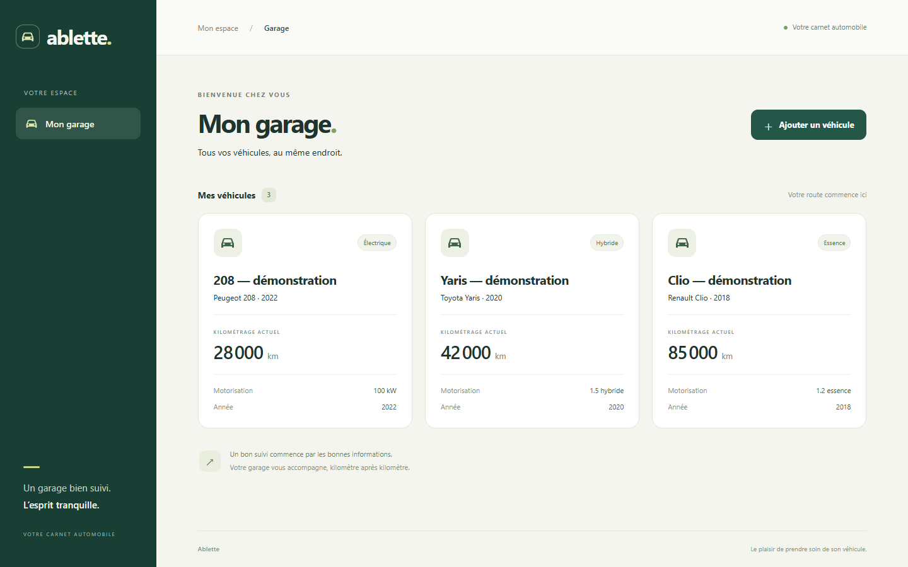

# Ablette

**A straightforward vehicle logbook with business rules implemented in Java.**

[Français](README.md) · [Architecture](docs/architecture.md) · [Lot 1 learning notes, in French](docs/lot-1.md)

Ablette 2.0 is a responsive Web application for personal car maintenance. **Lot 1 implements vehicle creation and listing backed by PostgreSQL.** Accounts, maintenance, invoices and the installable PWA are planned in subsequent milestones.

## Stack

Java 21, Spring Boot 4.1.1, Spring MVC, Spring Data JPA, Spring Security, PostgreSQL 17, Flyway, Bean Validation and OpenAPI. React/TypeScript with Vite, React Router, TanStack Query and Material UI. JUnit 6, Mockito, PostgreSQL Testcontainers, Vitest, React Testing Library, Maven Wrapper, Docker Compose and GitHub Actions.

## Run locally

Start Docker Desktop with its Linux engine. From the repository root in PowerShell:

```powershell
.\scripts\init-dev-env.ps1
docker compose up --build -d
```

The script generates a random PostgreSQL password in an ignored `.env`, without printing it or overwriting an existing configuration. On Linux/macOS, copy `.env.example` to `.env` and set a locally generated random `POSTGRES_PASSWORD`.

- Application: <http://127.0.0.1:8081/garage>
- Swagger: <http://127.0.0.1:8080/swagger-ui/index.html>
- REST API: <http://127.0.0.1:8080/api/v1/vehicles>

This milestone is **local development only**: account authentication and isolation are planned for lot 4. All published ports bind to loopback. The backend only permits garage requests when the `local` profile is explicitly selected; it denies requests otherwise. Use fictional data until account security is implemented.

`docker compose stop` preserves the database. The named `postgres-data` volume holds your vehicles. Do not remove it when stopping the application.

## Persistence demonstration

Create a vehicle through the application, reload, restart the database and backend with `docker compose restart db backend`, and reopen the garage. The vehicle remains available.

With Node.js 24, this automated scenario creates an explicitly fictional vehicle, restarts both services and verifies its identifier and saved values:

```sh
node scripts/verify-persistence.mjs
```

No Flutter demo data is imported. Integration tests run against separate, disposable PostgreSQL databases.



[Mobile screenshot, 375 px](docs/screenshots/garage-375.png) · [Tablet screenshot, 768 px](docs/screenshots/garage-768.png).

## Development and checks

Install JDK 21 and Node.js 24. Stop the application containers with `docker compose stop backend frontend` to free their ports, then start PostgreSQL with `docker compose up -d db`. In your backend terminal, set `DB_URL`, `DB_USER` and `DB_PASSWORD` from the local `.env`, and `SPRING_PROFILES_ACTIVE=local`. Then run the Maven Wrapper; no global Maven installation is required:

```sh
cd backend
./mvnw spring-boot:run
```

In another terminal:

```sh
cd frontend
npm ci
npm run dev
```

The development interface runs at <http://127.0.0.1:5173/garage> with a same-origin API proxy. On Windows, use `mvnw.cmd` and `npm.cmd` where appropriate.

```sh
cd backend
./mvnw --batch-mode --no-transfer-progress verify
cd ../frontend
npm ci
npm test
npm run build
```

`mvnw test` runs unit, MVC and security tests. `mvnw verify` also runs PostgreSQL integration tests with Testcontainers; unavailable Docker fails the check instead of silently skipping it. CI runs the checks on Ubuntu using Java 21 and Node 24. Corporate certificate environments can use the system trust store; TLS verification must remain enabled. See the French README for Windows commands.

## Structure and milestones

`backend/` contains the API, migrations and tests; `frontend/` contains React; `docs/` explains architecture and business decisions; `scripts/` provides local setup and persistence verification. The original Flutter prototype, including existing local files, is preserved under `prototype/flutter/` and Git tag `archive/flutter-prototype-2026-10-21` at commit `55d0a03`. Existing untracked files are preserved and not automatically published.

The roadmap is: persistent garage → maintenance rules → full interface → account security/documents → portfolio/PWA/HTTPS demonstration. Each milestone includes explanations and automated checks. Future capabilities are not simulated in the current interface.
