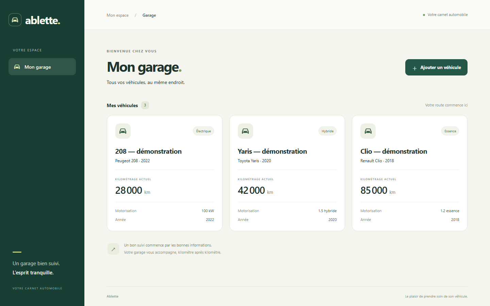

# Ablette

**Un carnet automobile simple, un backend Java qui porte les règles métier.**

[English](README.en.md) · [Architecture et données](docs/architecture.md) · [Comprendre le lot 1](docs/lot-1.md)

Ablette 2.0 est une application Web responsive de suivi d'entretien automobile. **Le lot 1 livre la création et la consultation de véhicules avec PostgreSQL.** Les comptes, les entretiens, les factures et la PWA seront ajoutés par lots successifs.

## Stack

- Java 21, Spring Boot 4.1.1, Spring MVC, Spring Data JPA, Spring Security.
- PostgreSQL 17, Flyway, Bean Validation, OpenAPI / Swagger.
- React, TypeScript, Vite, React Router, TanStack Query et Material UI.
- JUnit 6, Mockito, Testcontainers PostgreSQL, Vitest et React Testing Library.
- Maven Wrapper, Docker Compose et GitHub Actions.

## Lancer avec Docker

Prérequis : Docker Desktop démarré avec son moteur Linux. La première compilation télécharge les images et dépendances.

Dans PowerShell, à la racine du dépôt :

```powershell
.\scripts\init-dev-env.ps1
docker compose up --build -d
```

Le script crée un `.env` ignoré par Git, avec un mot de passe PostgreSQL aléatoire. Il conserve un `.env` déjà existant et n'affiche jamais son contenu. Sous Linux/macOS, copier `.env.example` vers `.env` et renseigner `POSTGRES_PASSWORD` avec une valeur aléatoire locale.

- Application : <http://127.0.0.1:8081/garage>
- Swagger : <http://127.0.0.1:8080/swagger-ui/index.html>
- API : <http://127.0.0.1:8080/api/v1/vehicles>
- Santé : <http://127.0.0.1:8080/actuator/health>

Tous les ports publiés sont liés à `127.0.0.1`. **Ce premier lot utilise uniquement des données locales fictives : l'authentification et l'isolation des comptes sont prévues au lot 4.** Le profil `local` doit être activé explicitement ; le backend refuse les requêtes hors de ce profil. Ce lot n'est pas destiné à une exposition publique.

Pour arrêter l'application en conservant les véhicules :

```powershell
docker compose stop
```

Le volume nommé `postgres-data` conserve la base. Ne pas utiliser `docker compose down -v` pour un arrêt normal : cette option détruirait le volume.

## Vérifier la persistance

Dans l'interface, cliquer sur **Ajouter un véhicule**, remplir ses informations et valider. Le véhicule apparaît dans le garage. Recharger la page, redémarrer les services, puis rouvrir le garage : il doit toujours être présent.

```powershell
docker compose restart db backend
```

Un scénario automatisé est aussi fourni ; il nécessite Node.js 24 et crée un véhicule clairement nommé « DÉMO — persistance » dans la base locale. Il redémarre PostgreSQL et le backend, puis vérifie le même identifiant et toutes les valeurs enregistrées :

```powershell
node scripts/verify-persistence.mjs
```

Les données du prototype Flutter ne sont jamais importées automatiquement. Les tests d'intégration utilisent des bases PostgreSQL temporaires séparées.



Captures : [smartphone, 375 px](docs/screenshots/garage-375.png) · [tablette, 768 px](docs/screenshots/garage-768.png) · [formulaire mobile](docs/screenshots/form-375.png).

## Développer sans reconstruire les conteneurs applicatifs

Prérequis supplémentaires : JDK 21 et Node.js 24. Maven est téléchargé par le Wrapper.

```powershell
docker compose stop backend frontend
docker compose up -d db
# Dans ce terminal : charger uniquement les variables nécessaires au backend.
$taskConfig = ConvertFrom-StringData (Get-Content .env -Raw)
$env:DB_URL = 'jdbc:postgresql://127.0.0.1:' + $taskConfig.DB_PORT + '/' + $taskConfig.POSTGRES_DB
$env:DB_USER = $taskConfig.POSTGRES_USER
$env:DB_PASSWORD = $taskConfig.POSTGRES_PASSWORD
$env:SPRING_PROFILES_ACTIVE = 'local'
Set-Location backend
.\mvnw.cmd spring-boot:run
```

Dans un autre terminal :

```powershell
Set-Location frontend
npm.cmd ci
npm.cmd run dev
```

Application de développement : <http://127.0.0.1:5173/garage>. Le proxy Vite transmet les requêtes à l'API ; le navigateur ne conserve pas de réponses API hors ligne.

## Tests

```powershell
# JDK 21 et Docker démarré : tests unitaires ET intégration PostgreSQL.
Set-Location backend
.\mvnw.cmd --batch-mode --no-transfer-progress verify

# Tests de composants et compilation TypeScript / Vite.
Set-Location ..\frontend
npm.cmd ci
npm.cmd test
npm.cmd run build
```

`mvnw test` exécute les tests Java unitaires, MVC et de sécurité. `mvnw verify` ajoute les scénarios `*IT` avec Testcontainers : un Docker indisponible fait échouer la vérification, il n'est pas ignoré silencieusement. La CI exécute ces vérifications sur Ubuntu avec Java 21 et Node 24.

Si votre environnement Windows utilise une autorité de certification locale, utiliser le magasin de confiance système plutôt que désactiver TLS : `NODE_OPTIONS=--use-system-ca` pour Node 24 ; pour Maven/Java sur Windows, `MAVEN_OPTS=-Djavax.net.ssl.trustStoreType=Windows-ROOT -Djavax.net.ssl.trustStore=NONE`.

## Organisation et progression

```text
backend/             API Java, migrations SQL et tests
frontend/            Application React et tests de composants
docs/                Architecture, modèle de données et explications
scripts/             Configuration locale et démonstration de persistance
prototype/flutter/   Prototype original conservé, fichiers locaux compris
.github/workflows/   Vérifications automatiques
compose.yaml         PostgreSQL, API et interface
```

Le prototype original est également conservé par le tag Git `archive/flutter-prototype-2026-10-21`, sur le commit `55d0a03`. Les fichiers non suivis existants ont été conservés ; ils ne sont pas publiés automatiquement. Le nouveau travail utilise la branche `codex/ablette-2-lot1`.

1. **Fondations :** garage persistant, API, première interface et tests.
2. **Maintenance :** relevés, opérations, interventions, échéances calculées en Java.
3. **Interface complète :** synthèse, recherche, filtres, dépenses et historique.
4. **Sécurité et documents :** comptes, sessions, contrôle d'accès et justificatifs.
5. **Portfolio :** PWA installable, démonstration fictive isolée, présentation et hébergement HTTPS.

La présence d'un domaine dans la cible d'architecture ne signifie pas qu'il est déjà implémenté. Les fonctionnalités des lots suivants ne sont pas simulées dans l'interface.
