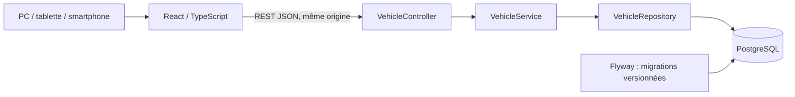
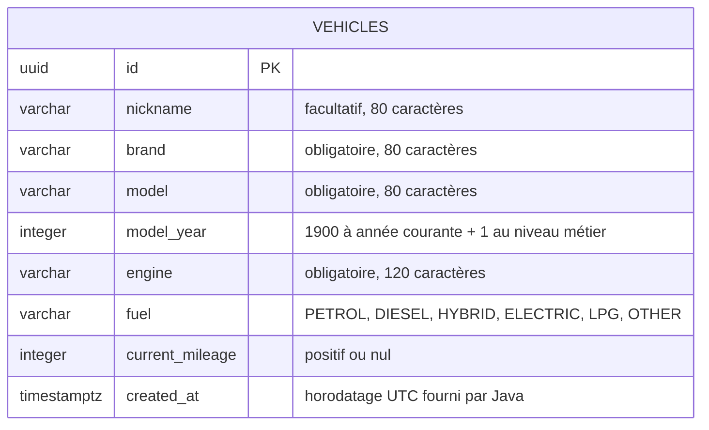

# Architecture — Ablette 2.0

Ablette est un monolithe modulaire Java avec une interface React. Une seule API et une seule base PostgreSQL suffisent au besoin actuel.

Les domaines cibles sont `vehicle`, `mileage`, `maintenance`, `dashboard` et `account`. Seul `vehicle` est livré au lot 1 ; les autres seront introduits avec leur premier cas d'usage. Les packages ne contiennent pas de classes vides simplement pour annoncer une fonctionnalité.

Chaque domaine conserve ses Controller, Service, Repository, Entity et DTO. Les échanges entre domaines passeront par des services explicites. Les règles métier appartiennent à Java ; React gère la saisie, l'affichage et les états réseau.

## Modèle relationnel du lot 1

`V1__create_vehicles.sql` crée cette table et ses contraintes. Flyway est la référence du schéma ; Hibernate démarre en mode `validate`. Les identifiants UUID et la date de création sont générés par le backend. Le surnom vide devient `null`, les textes sont nettoyés, et les autres informations sont requises.

Les règles du lot 1 sont : compteur entier positif ou nul, année au moins égale à 1900 et au plus égale à l'année courante + 1, longueurs limitées et carburant explicite. L'année est calculée avec une `Clock` injectée pour permettre des tests déterministes. Le suivi d'un compteur croissant ne peut pas encore s'appliquer : les relevés datés seront introduits au lot 2.

## Contrat REST

| Méthode et chemin | Réponse |
|---|---|
| `GET /api/v1/vehicles` | Tableau de DTO, plus récents en premier |
| `GET /api/v1/vehicles/{id}` | DTO du véhicule ou 404 |
| `POST /api/v1/vehicles` | 201, DTO créé et en-tête `Location` |
| `GET /v3/api-docs` | Contrat OpenAPI généré |
| `GET /actuator/health` | État du service sans détails de la base |

Les erreurs de validation renvoient un `ProblemDetail` et une propriété `errors` associant les champs à des messages français. Les erreurs techniques et SQL ne sont pas retournées à l'utilisateur. Les propriétés réservées au serveur et les décimales sur le compteur sont refusées.

Les DTO Java `CreateVehicleRequest` et `VehicleResponse` définissent l'API ; l'entité JPA `Vehicle` reste interne. TanStack Query invalide la liste après création et la recharge depuis l'API. Les données métier ne sont pas persistées dans le stockage du navigateur.

## Sécurité et déploiement progressifs

Le profil `local` ouvre seulement les routes nécessaires au garage, à la documentation et à la santé. Hors de ce profil, toutes les requêtes sont refusées. Le lot 1 n'offre pas de comptes : ses données de développement ne sont pas cloisonnées par utilisateur et ne doivent pas être exposées publiquement.

La création du domaine `account` au lot 4 apportera sessions sécurisées, protection CSRF, inscription/connexion et contrôles de propriété sur chaque ressource. Le futur schéma rattachera les véhicules à leur propriétaire. Le choix de repousser ces fonctionnalités suit les lots validés et n'est pas présenté comme une sécurité utilisateur déjà livrée.

Docker Compose utilise un volume PostgreSQL persistant, des ports publiés uniquement en boucle locale et un mot de passe fourni par un `.env` ignoré. Les conteneurs Java et Nginx s'exécutent sans privilèges. La PWA du lot 5 n'ajoutera pas implicitement un cache des données personnelles.

## Règles à développer au lot 2

Relevés datés cohérents, origine d'entretien stable, événements d'intervention conservés, calcul date/km au premier critère atteint, seuils configurables et état « historique inconnu ». Les intervalles génériques seront présentés comme indicatifs et modifiables. Les cas de fin de mois et d'année bissextile seront traités avec `LocalDate` et une horloge contrôlée par les tests.
